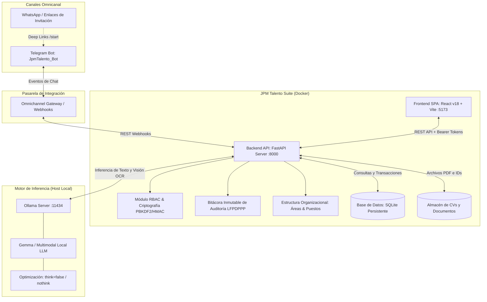

# JPM Talento - Plataforma Inteligente de Reclutamiento y Selección con IA

**JPM Talento** es un ecosistema integral de última generación desarrollado para el área de **Recursos Humanos** de JPM (Jubilación y Pensión Máxima). Combina Inteligencia Artificial local (privada, confidencial y acelerada por hardware), pre-entrevistas omnicanal automatizadas con agentes conversacionales (Telegram/WhatsApp), evaluación de compatibilidad de CVs en tiempo real, control de acceso basado en roles (**RBAC Granular**), asignación y dictamen formal de evaluadores por etapa, bitácora inmutable de auditoría (**LFPDPPP**), estructura organizacional dinámica con **aprovisionamiento por puestos** y un **Sandbox / Simulador interno** para calibración y pruebas.

---

## 🏗️ Arquitectura General del Sistema

El ecosistema opera bajo un modelo desacoplado y de alto rendimiento que aprovecha la aceleración por hardware local (GPU/NPU) para la inferencia de IA, mientras ejecuta la lógica de negocio, seguridad y frontend en contenedores Docker:



---

## 🚀 Módulos y Capacidades Principales

### 1. 🛡️ Control de Acceso Basado en Roles (RBAC Granular) y Criptografía
- **Seguridad Criptográfica**: Hashing de contraseñas con algoritmo `PBKDF2-HMAC-SHA256` (100,000 iteraciones + salt aleatorio de 16 bytes). Tokens de sesión URL-safe firmados criptográficamente mediante `HMAC-SHA256`.
- **Matriz de 13 Permisos Granulares**:
  `candidates:read`, `candidates:create`, `candidates:edit`, `candidates:delete`, `candidates:transfer`, `id_docs:view`, `id_docs:purge`, `vacancies:manage`, `kanban:manage`, `evaluations:submit`, `settings:manage`, `audit:read`, `users:manage`.
- **7 Roles Corporativos Predefinidos**:
  1. **Super Administrador (`SuperAdmin`)**: Control total de módulos, usuarios, bitácoras y panel de diagnóstico de TI.
  2. **Gerente de RH (`Gerente_RH`)**: Gestión integral de selección, candidatos, vacantes y reportes operativos.
  3. **Reclutador Senior (`Reclutador_Senior`)**: Operación completa de expedientes, vacantes, evaluación de INE y transferencias.
  4. **Reclutador Junior (`Reclutador_Junior`)**: Filtro preliminar de candidatos y movimiento en etapas iniciales.
  5. **Gerente de Vacante (`Gerente_Vacante`)**: Hiring Manager asignado para dictamen formal de *Entrevista* y *Roleplay*.
  6. **Evaluador de Capacitación (`Evaluador_Capacitacion`)**: Instructor titular para dictámenes técnicos de *Capacitación 1* y *Capacitación 2*.
  7. **Auditor de Privacidad (`Auditor_Privacidad`)**: Inspección de bitácora LFPDPPP y ejecución de purga documental por Derechos ARCO.

### 2. 📝 Dictamen Formal de Etapas y Avance Automático
- Botón **"📝 Dictaminar Etapa"** en el expediente del candidato.
- Captura de **Calificación (0 a 100)**, **Veredicto Oficial** (`Aprobado`, `En Refuerzo`, `No Aprobado`) y retroalimentación cualitativa.
- **Firma Automática y Blindaje de Autoría**: El sistema genera una nota inmutable en el expediente indicando nombre, rol, área y fecha/hora del evaluador.
- **Avance Dinámico**: Si el dictamen es *Aprobado*, el candidato avanza automáticamente a la etapa subsiguiente en el Tablero Kanban.

### 3. 🔒 Bitácora Inmutable de Auditoría y Cumplimiento LFPDPPP
- Registro detallado y no editable de eventos sensibles:
  `LOGIN`, `VIEW_INE_DOCUMENT`, `DOWNLOAD_CV`, `SUBMIT_EVALUATION`, `TRANSFER_CANDIDATE`, `PURGE_INE_DOCUMENT`, `USER_CREATED`, `USER_PURGED`, etc.
- Almacenamiento de marca de tiempo ISO, correo del responsable, rol, IP de origen, tipo de recurso y detalles de la operación.
- **Mecanismo de Purga ARCO**: Permite la destrucción física y criptográfica de fotos de identificaciones oficiales sin romper el registro de historial.

### 4. 🏢 Estructura Organizacional Dinámica y Aprovisionamiento por Puesto
- **Catálogo Dinámico de Áreas y Departamentos (`Department`)**: Sustituye listas fijas hardcodeadas por un modelo con código mnemotécnico, nombre, descripción, **Gerente Titular** y **Evaluador de Capacitación Titular**.
- **Efecto Cascada en Vacantes**: Al crear una vacante y asignarle un Área, el sistema auto-selecciona de forma inteligente al Hiring Manager y al Evaluador correspondientes.
- **🎯 Aprovisionamiento Basado en Puesto (Template Provisioning)**: En el alta de colaboradores, permite seleccionar una posición clave del organigrama (ej. *Gerente Titular de Ventas*); el sistema preconfigura el área, asigna el rol RBAC adecuado y vincula la titularidad automáticamente.
- **🛠️ Configuración Manual**: Permite crear reclutadores o auditores con área opcional para evitar dependencias circulares.

### 5. 🗑️ Ciclo de Vida Seguro y Blindaje Contra Datos Huérfanos
- **Soft Delete (`Desactivar`)**: Oculta áreas o usuarios de nuevos procesos preservando la integridad del historial.
- **Hard Delete (`Eliminar Definitivamente`) con Validación de Dependencias**:
  - **Áreas**: El backend bloquea la eliminación si existen vacantes asociadas (activas o históricas), informando que deben ser reasignadas primero para no dejar postulaciones huérfanas.
  - **Usuarios**: Se bloquea la eliminación si el colaborador es Hiring Manager de vacantes abiertas; protege contra auto-eliminación y blinda la cuenta raíz `admin@jpm.com`.

### 6. 📊 Analítica Estratégica: Tasa de Conversión por Plataforma
- Tarjeta ejecutiva en el Dashboard que calcula en tiempo real:
  - **Efectividad Real**: Contratados vs Total de postulantes por bolsa de empleo (OCC, Computrabajo, Indeed, LinkedIn, etc.).
  - **Tasa de Conversión %**: Con barras visuales de rendimiento (🟢 ≥15%, 🟡 ≥5%, 🔵 Inicial).
  - **Tasa de Avance**: Porcentaje de candidatos que superan el filtro inicial de pre-entrevista.
  - **Calidad Media (Score IA)**: Afinidad promedio del talento atraído por cada fuente.
- **Segregación TI**: El monitor técnico de servidores y Ollama se presenta exclusivamente al perfil `SuperAdmin`, manteniendo la vista ejecutiva limpia para el equipo operativo.

### 7. 🤖 Samanta: Asistente Virtual de Pre-entrevista (Punto 7 RH)
Agente de IA diseñado para el filtro inicial mediante un embudo secuencial estandarizado de **6 pasos**:
1. **Inicio de Conversación**: Vinculación automática con `/start app_{id}`.
2. **Aviso de Privacidad y Políticas (LFPDPPP)**: Consentimiento legal informado.
3. **Entrevista de Perfilamiento**: Máximo 2 preguntas comerciales aplicando escucha activa empática.
4. **Disponibilidad y Pretensiones**: Indagación de horario y pretensión económica mensual.
5. **Cierre Automático y Resumen Ejecutivo**: Despedida cordial y redacción de nota ejecutiva en viñetas.
6. **Verificación Oficial**: Solicitud de identificación oficial.

### 8. 🪪 Blindaje de Identidad con Visión Multimodal (INE / CURP)
- Análisis de imagen con IA multimodal para credenciales INE o pasaportes.
- Extracción de **CURP de 18 caracteres**, fecha de nacimiento y **cálculo exacto de edad**.
- **Cotejo de Nombre**: Detección de discrepancias entre la identificación y la postulación para evitar suplantaciones.

### 9. 🧪 Sandbox & Simulador Interno de Samanta
- Entorno de pruebas interactivo (`#simulator`) para calibrar prompts y probar respuestas sin impactar la base de datos de producción.
- Soporte de candidatos de prueba (Senior, Junior) y candidatos reales, simulación de chat interactivo y panel inspector de System Prompt.

---

## 📂 Estructura Modular del Proyecto

```text
RRHH/
├── backend/
│   ├── app/
│   │   ├── routers/
│   │   │   ├── auth_rbac.py        # Autenticación, RBAC, usuarios, áreas y dictamen de etapa
│   │   │   ├── candidates.py       # API de candidatos, fuentes, CVs, INE y auditoría ARCO
│   │   │   ├── vacancies.py        # Vacantes, evaluadores, Kanban y conversión por fuente
│   │   │   ├── webhook_listener.py # Webhooks omnicanal de Telegram
│   │   │   └── simulator.py        # Sandbox y simulador interactivo de IA
│   │   ├── services/
│   │   │   ├── ai_service.py       # Cliente Ollama (think=false, visión multimodal y texto)
│   │   │   ├── audit_service.py    # Servicio inmutable de bitácora LFPDPPP
│   │   │   ├── cv_processing_service.py # Extracción estructurada de CVs
│   │   │   ├── scoring_service.py  # Algoritmo de afinidad y evaluación ponderada
│   │   │   └── vacancy_service.py  # Lógica de vacantes y asignación de evaluadores
│   │   ├── models.py               # Modelos SQLAlchemy (Users, Roles, Departments, etc.)
│   │   ├── schemas.py              # Esquemas de validación Pydantic
│   │   ├── migrate_schema.py       # Migraciones incrementales de base de datos
│   │   ├── seed_rbac.py            # Semillero inicial de roles, permisos, áreas y usuarios
│   │   ├── database.py             # Conexión y sesión SQLite
│   │   └── main.py                 # Entrada FastAPI, middlewares CORS/CSP y routers
│   └── Dockerfile
├── frontend/
│   ├── src/
│   │   ├── App.jsx                 # SPA React (Dashboard, Kanban, RBAC, Áreas, Sandbox)
│   │   ├── index.css               # Sistema de diseño, tokens, tablas y modo oscuro
│   │   └── main.jsx
│   ├── package.json
│   └── vite.config.js
├── docs/
│   ├── MANUAL_DE_USUARIO.md        # 📖 Manual operativo completo para Recursos Humanos
│   ├── architecture.md             # Especificación técnica y decisiones de arquitectura
│   ├── database.md                 # Diccionario de datos, relaciones y constraints
│   ├── ai-processing.md            # Especificaciones de prompts e inferencia local
│   ├── scoring.md                  # Algoritmo de ponderación y criterios
│   └── deployment.md               # Guía de despliegue y puesta en producción
├── sync_backend.bat                # Script de sincronización continua con Docker
├── docker-compose.yml              # Orquestación de contenedores (backend, frontend)
└── README.md                       # Documentación principal
```

---

## 🔑 Cuentas de Acceso Preconfiguradas (Demo / Pruebas)

Al desplegar o sincronizar la plataforma, el semillero inicial crea los siguientes perfiles para pruebas de RBAC:

| Rol | Correo Electrónico | Contraseña | Alcance / Permisos Principales |
|---|---|---|---|
| **SuperAdmin** | `admin@jpm.com` | `Admin1234!` | Control total, gestión de usuarios, bitácora y diagnóstico TI. |
| **Gerente de RH** | `reclutador@jpm.com` | `Reclutador123!` | Reclutamiento, vacantes, candidatos y configuraciones de bot. |
| **Gerente de Vacante** | `gerente.ventas@jpm.com` | `Gerente123!` | Hiring Manager: Dictamen de *Entrevista* y *Roleplay*. |
| **Evaluador Capacitación**| `capacitador@jpm.com` | `Capacita123!` | Instructor Líder: Dictamen de *Capacitación 1* y *2*. |
| **Auditor de Privacidad** | `auditor@jpm.com` | `Auditor123!` | Consulta de Bitácora LFPDPPP y purga documental ARCO. |

---

## 🛠️ Requisitos del Sistema

- **Docker Desktop** (con soporte para contenedores Linux).
- **Ollama** instalado en la máquina física (Host) en el puerto `11434`.
- **Modelo LLM Local**: `gemma4:12b-it-qat` (o similar con capacidades multimodales para lectura de identificación).
- **Navegador Web Moderno** (Chrome, Edge, Brave, Firefox).

---

## 🚀 Despliegue y Puesta en Marcha

### 1. Iniciar los Contenedores
```powershell
docker compose up -d --build
```
- **Frontend SPA**: `http://localhost:5173`
- **Backend API**: `http://localhost:8000` (Swagger UI interactivo en `/docs`)

### 2. Sincronización Continua del Backend
Tras realizar modificaciones en `backend/app/`, sincroniza los archivos al contenedor en caliente sin reconstruir la imagen:
```powershell
.\sync_backend.bat
```

---

## 📖 Documentación Complementaria

- 📘 **[Manual de Usuario](docs/MANUAL_DE_USUARIO.md)**: Guía paso a paso para el personal operativo y gerencial.
- 🏛️ **[Arquitectura del Sistema](docs/architecture.md)**: Separación modular, seguridad y flujos de datos.
- 🗄️ **[Esquema de Base de Datos](docs/database.md)**: Modelo relacional, tablas, relaciones e índices.

---

*JPM (Jubilación y Pensión Máxima) | Dirección de Recursos Humanos y Tecnología.*
