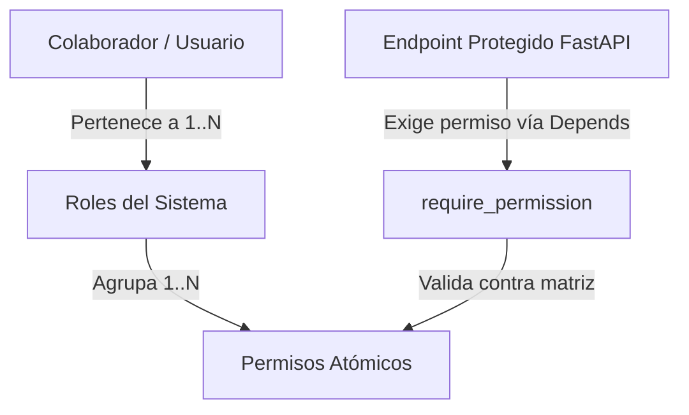
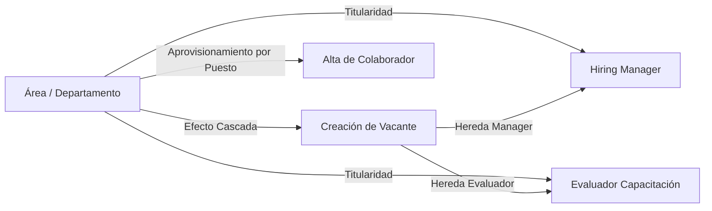

# Arquitectura Técnica del Sistema - JPM Talento

Este documento describe en detalle la arquitectura técnica, la separación de responsabilidades, los patrones de diseño y las medidas de seguridad del ecosistema **JPM Talento**.

---

## 1. Vista General de la Arquitectura Híbrida

El sistema opera bajo un modelo **híbrido desacoplado** que optimiza el rendimiento del hardware ejecutando los modelos de Inteligencia Artificial directamente sobre el Host (aprovechando la GPU/NPU del equipo local), mientras que la lógica de negocio, la seguridad criptográfica y la persistencia de datos se ejecutan en contenedores virtualizados con Docker.

```text
                                MÁQUINA FÍSICA (HOST)
┌────────────────────────────────────────────────────────────────────────────────────────┐
│                                                                                        │
│                          Ollama Engine (Inferencia de IA)                              │
│                            ├── Inferencia de Texto (Gemma LLM)                         │
│                            ├── Visión Artificial Multimodal (OCR de Identificaciones)  │
│                            ├── Optimización: think=false / nothink                     │
│                            └── Puerto Local: :11434                                    │
│                                                                                        │
│   ┌────────────────────────────────────────────────────────────────────────────────┐   │
│   │                         ENTORNO DOCKER CONTAINERIZADO                          │   │
│   │                                                                                │   │
│   │   ┌────────────────────────┐                   ┌───────────────────────────┐   │   │
│   │   │     Frontend SPA       │                   │       Backend Core        │   │   │
│   │   │   (React v18 + Vite)   │───Bearer Token───►│     (FastAPI Server)      │   │   │
│   │   │      Puerto :5173      │                   │       Puerto :8000        │   │   │
│   │   └────────────────────────┘                   └─────────────┬─────────────┘   │   │
│   │                                                              │                 │   │
│   │               ┌──────────────────────────────────────────────┼─────────────┐   │   │
│   │               │                                              │             │   │   │
│   │               ▼                                              ▼             ▼   │   │
│   │     ┌──────────────────┐                           ┌───────────┐ ┌─────────┐   │   │
│   │     │   Capa de RBAC   │                           │  SQLite   │ │ Almacén │   │   │
│   │     │  & Criptografía  │                           │    DB     │ │ de PDFs │   │   │
│   │     │  (PBKDF2 / HMAC) │                           │  (data/)  │ │(storage)│   │   │
│   │     └──────────────────┘                           └───────────┘ └─────────┘   │   │
│   │               │                                                                │   │
│   │               ▼                                                                │   │
│   │     ┌──────────────────┐                                                       │   │
│   │     │  Bitácora Audit  │                                                       │   │
│   │     │   (LFPDPPP)      │                                                       │   │
│   │     └──────────────────┘                                                       │   │
│   └────────────────────────────────────────────────────────────────────────────────┘   │
│                                                                                        │
└────────────────────────────────────────────────────────────────────────────────────────┘
```

---

## 2. Capas del Sistema y Módulos de Software

### 2.1 Capa de Presentación (Frontend SPA)
Construida con **React v18** y empaquetada mediante **Vite**:
- **Gestión de Estado**: Hooks reactivos (`useState`, `useEffect`, `useRef`) para sincronización en tiempo real sin sobrecarga de dependencias externas.
- **Polling Inteligente**: Consulta en segundo plano únicamente cuando existen candidatos en extracción o evaluaciones de IA pendientes de puntuación.
- **Sistema de Diseño (Vanilla CSS)**: Tokens CSS personalizados en `index.css`, componentes basados en tarjetas con efectos de profundidad y temas visuales accesibles.
- **Seguridad en Navegación**: Validación de permisos del usuario (`hasPermission`) para ocultar/proteger acciones restringidas (como purga de documentos, diagnósticos de TI o edición de configuraciones).

### 2.2 Capa de API y Lógica de Negocio (FastAPI Backend)
Estructurada modularmente mediante sub-enrutadores (`APIRouter`):
1. **`auth_rbac.py`**:
   - Autenticación (`/api/auth/login`), emisión y verificación de tokens.
   - Administración de usuarios y catálogo de roles (`/api/auth/users`, `/api/auth/roles`).
   - Dictámenes formales de evaluación de etapa (`/api/auth/evaluations`).
   - Consulta de eventos de auditoría (`/api/auth/audit-logs`).
2. **`dept_router` (Áreas Organizacionales)**:
   - CRUD de áreas y departamentos (`/api/departments`).
   - Asignación y desvinculación de Hiring Managers y Evaluadores Titulares.
   - Eliminación con validación estricta de dependencias.
3. **`vacancies.py`**:
   - Gestión de vacantes, criterios ponderados de evaluación y rangos de edad.
   - Transiciones del embudo Kanban y postulaciones.
   - Cálculo analítico de **Tasa de Conversión por Plataforma**.
4. **`candidates.py`**:
   - Carga y procesamiento de currículums en PDF.
   - Extracción de datos con IA y visor de documentos.
   - Consulta y purga ARCO de credenciales oficiales (INE).
5. **`webhook_listener.py`**:
   - Conexión omnicanal con bots de mensajería (Telegram).
   - Manejo del embudo conversacional de 6 pasos de Samanta.
6. **`simulator.py`**:
   - Sandbox interactivo para pruebas de prompts y lecturas OCR sin tocar producción.

---

## 3. Modelo de Seguridad y Control de Acceso (RBAC)

El sistema incorpora un modelo **Role-Based Access Control (RBAC)** con control granular a nivel de endpoint:



### 3.1 Criptografía y Sesiones
- **Hashing de Contraseñas**: Se utiliza `PBKDF2` con algoritmo de digestión `SHA-256`, 100,000 iteraciones y un salt criptográfico aleatorio de 16 bytes (`os.urandom(16)`). La contraseña almacenada tiene el formato `salt_hex:hash_hex`.
- **Tokens de Sesión Firmados**: No se requiere de un servidor externo de autenticación; se implementan tokens codificados en base64 URL-safe estructurados como `user_id:email:expiracion:firma_hmac_sha256`. Cualquier alteración en la expiración o el identificador invalida inmediatamente el token.

### 3.2 Matriz de Roles y Permisos
El sistema clasifica las operaciones en 13 permisos atómicos (`candidates:read`, `id_docs:purge`, `vacancies:manage`, `users:manage`, etc.), asignados a 7 roles:
- `SuperAdmin`: Posee bypass total de permisos y acceso al diagnóstico de infraestructura.
- `Gerente_RH`: Acceso operativo integral a candidatos, vacantes, configuraciones y bitácora.
- `Reclutador_Senior`: Gestión completa del embudo de candidatos, vacantes y evaluaciones.
- `Reclutador_Junior`: Revisión de candidatos y movimiento en etapas iniciales.
- `Gerente_Vacante`: Alcance limitado a evaluación de *Entrevista* y *Roleplay* para sus vacantes asignadas.
- `Evaluador_Capacitacion`: Alcance limitado a *Capacitación 1* y *2*.
- `Auditor_Privacidad`: Acceso a bitácoras de auditoría y ejecución de purgas documentales LFPDPPP.

---

## 4. Estructura Organizacional Dinámica e Inyección en Cascada

Para dotar al proceso de selección de la coherencia orgánica real de la empresa:



### 4.1 Efecto Cascada en Vacantes
Al seleccionar el Área (`department_id`) al crear o editar una vacante:
1. El sistema pre-selecciona automáticamente al **Gerente Titular** para las etapas de Entrevista y Roleplay.
2. El sistema pre-selecciona automáticamente al **Evaluador de Capacitación** para las etapas formativas.
3. Permite flexibilidad para cambiar los evaluadores si la vacante es delegada a un supervisor específico.

### 4.2 Aprovisionamiento Inteligente por Puesto
- En lugar de requerir que el usuario configure manualmente roles técnicos y departamentos, el modo **🎯 Aprovisionar por Puesto** permite elegir un puesto clave del organigrama (ej. *Gerente Titular de Ventas y Comercial*).
- El sistema deduce el área, asigna el rol RBAC correspondiente (`Gerente_Vacante`) y, tras la creación, vincula al colaborador como titular del área en la base de datos.

---

## 5. Integridad Referencial y Prevención de Datos Huérfanos

El sistema adopta una política estricta de protección de datos para evitar registros huérfanos o dependencias rotas:

### 5.1 Ciclo de Vida Dual (Soft Delete vs Hard Delete)
1. **Desactivación (Soft Delete)**:
   - Para `Department`: Se marca `is_active = False`. El área no aparece en nuevos formularios ni selectores de vacantes, pero sus postulaciones y métricas históricas permanecen intactas.
   - Para `User`: Se marca `is_active = False`. Se suspende el acceso al sistema sin alterar autorías ni notas firmadas.
2. **Eliminación Definitiva (Hard Delete / Purga)**:
   - **Para Áreas**: Antes de ejecutar `db.delete()`, se verifica si existen vacantes vinculadas (`Vacancy.department_id == dept.id`). Si existen vacantes, la petición se **rechaza con error 400**, exigiendo que las vacantes sean reasignadas o eliminadas previamente. Si no tiene vacantes, se desvinculan los colaboradores asignados (`department_id = NULL`) y se purga el registro.
   - **Para Usuarios**: No se permite auto-eliminación ni la eliminación del usuario raíz `admin@jpm.com`. Si el colaborador es Hiring Manager de vacantes activas abiertas, se bloquea la operación hasta su reasignación. Al eliminarse, libera limpiamente las referencias de gerencia en las áreas correspondientes.

---

## 6. Bitácora de Auditoría y Cumplimiento LFPDPPP

El módulo de auditoría (`AuditLog`) registra de forma persistente e inmutable los eventos sensibles:
- **Trazabilidad de Accesos a Datos Personales**: Visualización de fotos de credenciales de elector, descarga de currículums, transferencias de vacantes y dictámenes de etapa.
- **Registro de Metadatos**: Captura `timestamp`, `user_id`, `user_email`, `action`, `resource_type`, `resource_id`, `details` (JSON) y la dirección IP del cliente.
- **Derecho ARCO de Cancelación**: Permite la purga física y criptográfica de la credencial oficial de un candidato manteniendo el registro de auditoría del evento con severidad legal.

---

*Documentación de Arquitectura de JPM Talento | Versión 2.5.*
